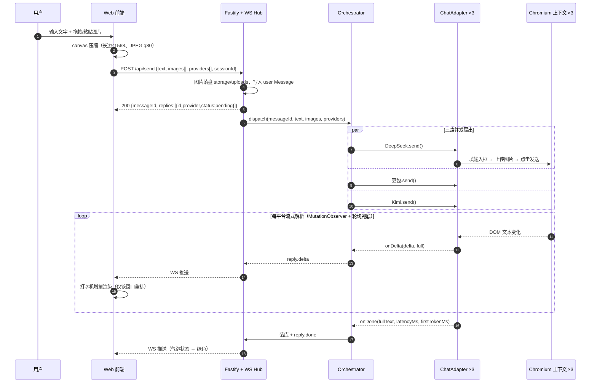
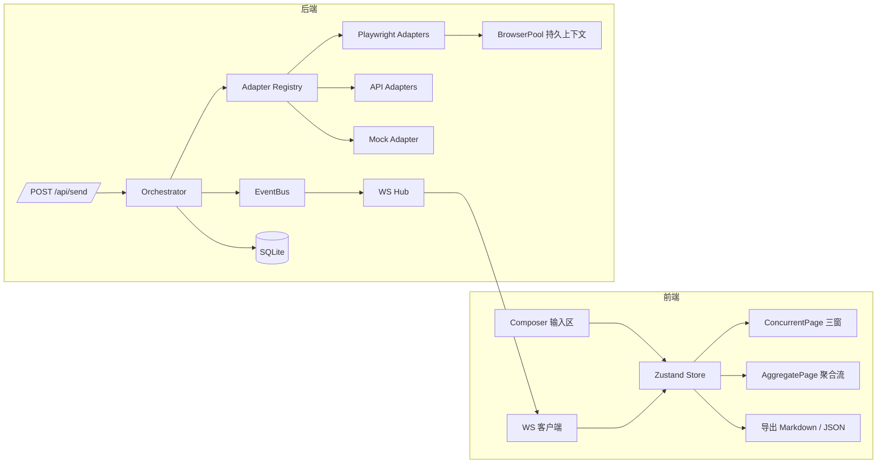

# 多 AI 聚合工作台 · 方案选型与架构设计

> 文档状态：**设计稿 v0 — 待你确认（确认后再写代码）**
> 项目目录：`multi-ai-workbench/`
> 日期：2026-10-12

---

## 0. 结论速览（TL;DR）

| 维度 | 结论 |
|---|---|
| 整体路线 | **路线 A（Playwright 驱动三家真实网页版）为主**，**路线 B（官方 API）为兜底**，两者藏在同一层 `ChatAdapter` 后面 → 最终交付形态即 **路线 C** |
| 前端 | React 18 + TypeScript + Vite + TailwindCSS + Zustand |
| 后端 | Node.js ≥ 20 + Fastify + `ws`（WebSocket） |
| 浏览器自动化 | Playwright（Chromium），每平台一个**持久化 `BrowserContext`**，登录态用 `storageState` 落盘 |
| 实时画面 | **默认不推画面**，只推结构化文本；"网页画面流"做成**可选开关**（CDP `Page.startScreencast`，低帧率低分辨率） |
| 存储 | 后端 SQLite（`better-sqlite3`）存会话/消息/回复；前端 `localStorage` 存 UI 偏好（勾选平台、并排模式、投票） |
| 部署 | 本机 `npm run dev`（推荐，便于有头过验证码）/ `docker-compose up`（容器内 headless 部署） |
| 交付形态优先级 | **Web 网站优先**；微信小程序**不做主形态**（原因见 §1.3） |

---

## 1. 前提澄清：为什么"iframe 嵌入"这条路从一开始就要放弃

你的任务书里已经点到了 `X-Frame-Options`，这里把它彻底讲透，因为它决定了整个架构。

### 1.1 三家 C 端网页版的硬性拦截

| 拦截机制 | 作用点 | 绕过难度 |
|---|---|---|
| `X-Frame-Options: DENY / SAMEORIGIN` | 浏览器拒绝渲染被嵌页面 | 需要反向代理剥离响应头 |
| `Content-Security-Policy: frame-ancestors` | 同上，优先级更高 | 同样需要剥离 |
| **同源策略（Same-Origin Policy）** | 即使渲染出来了，父页面**也读不到 iframe 内的 DOM** | **无法绕过**（除非同源） |
| C 端登录态（Cookie / localStorage token） | iframe 里带的是**你自己的域名**的 cookie，不是平台登录态 | 无法绕过 |
| 设备指纹 / 风控（Cloudflare、极验、自研） | 无头特征、异地 IP、异常频率 | 需真实浏览器 + 真实会话 |

**关键结论**：前两条可以用自建反向代理"技术上剥掉"，但**第三条（同源策略）剥不掉**——而第三条恰恰是"读取 AI 回复内容"的必经之路。

也就是说：
> 你想嵌入三家网页版 → 必须在**自己的源**里读到三家的 DOM。
> 要读到 DOM → 必须让浏览器在**三家的源**里跑（Playwright `BrowserContext` 天然满足）。
> 结论：**ifram 只能用来"看"，不能用来"用"**；真正的读写必须发生在后端的浏览器实例里。

### 1.2 反向代理方案为什么也不做

"用 Nginx 把 `chat.deepseek.com` 反代到 `localhost/deepseek`，剥掉响应头，就同源了" —— 理论可行，实践中三座大山：

1. **前端资源里全是绝对 URL + 平台鉴权域名**，反代后 CORS、WebSocket、CDN 域名会把页面打散，需要重写整站（等于自己做一次全站镜像）。
2. **登录态**依然要用户在我们的域名下输账号密码，等于伪造平台登录页，**法律与安全风险极高**。
3. 平台风控对"非官方域名 + 异常 Origin"会直接封禁，维护成本无底洞。

→ **明确不做**。这是把技术债、合规债、封号风险一次性全背身上。

### 1.3 微信小程序为什么不做主形态

- 小程序内**不能运行 Playwright / 无头浏览器**，必须配一个独立后端（等于我们这套后端原样搬过去）；
- 小程序**不支持 iframe**，网页画面流也只能用 `<image>` 走 WebSocket，体验比 Web 更差；
- 需要 **HTTPS + 已备案域名**，本机 demo 阶段拿不到；
- 小程序审核对"聚合第三方 AI 内容"敏感，上架周期不可控。

→ **结论：Web 优先做完整形态**。小程序若后续要做，定位为"只读查看端"（看历史会话 + 提问），复用同一套后端 API，不在本轮范围。

---

## 2. 三家平台的能力与限制（需在实施时逐项实测确认）

> ⚠️ 以下为**基于公开已知行为的判断**，不是实测结论。实施 Step 3 会写一个 `scripts/probe.ts` 逐项验证并回填本表。

| 项目 | DeepSeek | 豆包 | Kimi |
|---|---|---|---|
| 网页入口 | `chat.deepseek.com` | `www.doubao.com` | `www.kimi.com` |
| 登录方式 | 手机号 / 微信 | 抖音 / 手机号 | 手机号 / 微信 |
| 图片上传 | 输入框回形针 / 拖拽 | 输入框"+" / 拖拽 | 输入框"+" / 拖拽 |
| 输入框 | `textarea`（自动增高） | `textarea` / contenteditable | `textarea` |
| 流式完成判据 | 停止按钮消失 + 文本稳定 | 停止按钮消失 | 停止按钮消失 |
| 已知风控 | 频控、异地登录校验 | 抖音风控较强、滑块 | 相对宽松 |
| DOM 稳定性 | 中 | 低（改版频繁） | 中 |

**图片上传是所有平台最容易失效的一环**（入口按钮、`input[type=file]` 是否隐藏、是否走 OSS 预签名）。因此：
- 上传逻辑写成 `uploadImages(page, files)` 独立方法，每平台可覆写；
- 选择器**全部外置**到 `selectors/*.json`，改版只改配置不改代码（见 §6.2）。

---

## 3. 三条路线对比

| 维度 | 路线 A（Playwright 驱动网页版） | 路线 B（官方 API） | 路线 C（A 为主 + B 兜底） |
|---|---|---|---|
| 稳定性 | ★★☆☆☆（受 DOM 改版、风控影响） | ★★★★★ | ★★★★☆ |
| 视觉还原 | ★★★★★（就是 C 端窗口本身） | ★★☆☆☆（自研 UI） | ★★★★★ |
| 多模态（图片） | ★★★☆☆（靠 UI 上传，可能失效） | ★★★★★（原生支持） | ★★★★★ |
| 成本 | 免费（消耗账号额度） | 按 token 计费 | 混合 |
| 速度 | ★★☆☆☆（多一层浏览器渲染） | ★★★★★ | ★★★★☆ |
| 并发能力 | 受限于浏览器实例数与风控 | 高 | 高 |
| 合规/条款风险 | ★★☆☆☆（自动化操作 C 端，可能违反 ToS） | ★★★★★ | ★★★★☆ |
| 实现工作量 | 大 | 小 | 中（因为抽象层本来是共用的） |
| 反爬/验证码 | **必须处理** | 无 | 有兜底 |
| 演示观感 | 极佳（"真的三个窗口在同时干活"） | 一般 | 极佳 |

---

## 4. 选型结论

### 4.1 结论

> **采用路线 C 的形态：以 A 为默认执行通道，B 为配置化兜底通道，两者实现同一套 `ChatAdapter` 接口。**

理由：
1. 你的核心诉求是"把消息分发给三个**真实 C 端窗口**"，只有 A 能满足；
2. 但 A 的失败面（验证码、改版、封控）不可控，没有 B 兜底的产品是**不可交付**的；
3. 抽象层成本几乎为零（本来就要设计编排层），却换来"任何一家挂了都能降级"的能力；
4. 未来接入第 4 家 AI，只需新增一个 adapter 文件 + 注册一行。

### 4.2 `ChatAdapter` 抽象（设计契约）

```ts
// packages/server/src/adapters/types.ts
export type Provider = 'deepseek' | 'doubao' | 'kimi';

/** adapter 入参：一条用户消息的标准化形态 */
export interface AdapterInput {
  userMessageId: string;
  text: string;
  images: { path: string; mime: string; name: string }[]; // 后端本地绝对路径
  sessionKey: string;   // 平台侧会话标识（新会话会变化）
}

/** adapter 出参：通过回调把状态吐给编排层，而不是 return */
export interface ReplySink {
  onStatus(status: 'pending' | 'streaming' | 'done' | 'error'): void;
  onDelta(delta: string, full: string): void;          // 增量 + 全量快照
  onMeta(meta: { firstTokenMs?: number; latencyMs?: number; tokenEstimate?: number }): void;
  onError(err: { message: string; retryable: boolean; kind: 'auth' | 'captcha' | 'selector' | 'network' | 'unknown' }): void;
}

export interface ChatAdapter {
  readonly id: Provider;
  readonly displayName: string;          // "DeepSeek" / "豆包" / "Kimi"
  readonly route: 'playwright' | 'api' | 'mock';

  /** 启动/连接（playwright: 取出或创建 BrowserContext；api: 校验 key） */
  init(): Promise<void>;
  /** 健康检查：登录态是否有效、选择器是否命中、额度是否可用 */
  health(): Promise<{ ok: boolean; reason?: string }>;
  /** 发送一条消息，生命周期内持续回调 sink，直到 done/error 或 signal 中止 */
  send(input: AdapterInput, sink: ReplySink, signal: AbortSignal): Promise<void>;
  /** 中止当前生成（点平台自身的"停止"按钮） */
  stop(): Promise<void>;
  /** 平台侧"新建对话" */
  newSession(): Promise<string>;
  /** 释放资源 */
  dispose(): Promise<void>;
}
```

**编排层只认这个接口**，因此 `mock` / `playwright` / `api` 三种实现可以即插即用、可混用（例如 DeepSeek 走网页版、豆包走 API 兜底）。

### 4.3 目录结构与实现的关系

```
packages/server/src/adapters/registry.ts
  └─ PROVIDER_CONFIG['doubao'].route === 'playwright' ? new DoubaoWebAdapter() : new DoubaoArkAdapter()
```
路由由环境变量决定：`ADAPTER_DOUBAO=playwright|api|mock`，运行时可通过 `POST /api/providers/route` 热切换。

---

## 5. "实时画面"的工程取舍（重要）

你的任务书写的是"前端用 iframe 展示 Playwright 的实时画面（CDP screencast）"。**这里需要修正一个术语**：

> CDP `Page.startScreencast` 输出的是 **base64 JPEG 帧**，不是可访问的 URL，因此**不能用 iframe 展示**。
> 正确做法是：前端用 `` 或 `<canvas>` 逐帧渲染。

### 5.1 带宽测算（为什么默认关掉）

| 参数 | 单路 | 三路合计 |
|---|---|---|
| 1280×800、质量 60、JPEG | ~40–90 KB/帧 | — |
| 10 fps | ~0.4–0.9 MB/s | **~1.2–2.7 MB/s** |
| 1080p 全量帧、质量 80 | ~150–300 KB/帧 | — |
| 30 fps | ~4.5–9 MB/s | **~13–27 MB/s** |

三路同时推流会把 WebSocket 打爆（尤其在 Docker/公网场景）。因此设计为：

### 5.2 画面流的分级策略

| 级别 | 行为 | 适用 |
|---|---|---|
| `off`（默认） | 只推文本事件，前端完全自研 UI 回显 | 日常使用 |
| `thumb` | 640×400、质量 45、≤8 fps、**仅变化帧**、仅"被关注窗口"推 | 想确认"机器人在干活" |
| `full` | 1024×768、质量 70、≤15 fps | 调试/演示 |

关键实现点：
- `Page.startScreencast({ format: 'jpeg', quality, maxWidth, maxHeight, everyNthFrame })`；
- 每帧回 `Page.screencastFrameAck`（**不 ack 会停流**，这是最常见的坑）；
- 前端用 `IntersectionObserver` 上报"哪些窗口可见"→ WS 发 `screencast.interest`，后端**只对可见窗口推流**；
- 帧走 WS **二进制帧**（`Uint8Array` + 头部元信息），不要走 base64 JSON（省 33% 带宽）；
- 有 `auth.required` / `captcha` 时，**自动把该路切成 `full` + 有头窗口**，让用户直接看真人验证画面。

---

## 6. 风控、验证码与降级方案（必须显式说明）

自动化 C 端网页版，**一定会遇到**下面这些问题。架构上必须预留，而不是事后打补丁。

### 6.1 已知风险清单

| 风险 | 现象 | 处置 |
|---|---|---|
| 登录态过期 | 页面跳登录页 | `health()` 检测 → `auth.required` 事件 → 前端弹窗引导 |
| 滑块/点选验证码 | 发送后卡住、出现验证 iframe | 检测 `captcha` 选择器 → 切有头模式 → **人工过一次** → 存 `storageState` |
| 短信/设备校验 | 提示"新设备登录验证" | 同上，人工处置 |
| 频控 | 429 / 提示发送过于频繁 | `retryable=true` + 指数退避（1s/3s/9s） |
| DOM 改版 | 选择器全部 miss | `selectors/*.json` 热更新；`health()` 提前暴露 |
| 图片上传失败 | 图片没进输入框 | 校验"消息区出现图片缩略图"再点发送，否则走"仅文字 + 附链接"降级 |
| 无头特征识别 | 直接返回验证页 | `playwright-extra` + `stealth` 插件、真实 `userAgent`、`locale=zh-CN`、`timezoneId=Asia/Shanghai` |

### 6.2 降级阶梯（L0 → L4）

```
L0 全自动无头运行
   ↓ 检测到登录失效 / 验证码 / 选择器全 miss
L1 单平台切"人工介入"：后端以有头模式打开该平台窗口 + 前端弹窗
    用户手动登录/过验证 → 点"我已完成" → 保存 storageState → 自动回到 L0
   ↓ 连续 N 次仍失败（N=3，阈值可配）
L2 该平台选择器热重载（远端拉取 selectors 覆盖包）
   ↓ 仍失败
L3 该平台自动回落 API adapter（若配置了 key），气泡角标显示"API 兜底"
   ↓ 未配置 key
L4 该平台标记为"不可用"，前端显示错误态 + 一键重试；其余两家正常输出
```

**任何一级降级都必须在 UI 上可见**，不允许静默失败——这是产品可信度的底线。

### 6.3 合规提示

自动化操作 C 端网页可能违反平台服务条款。建议：
- 只在**本人账号**、**低频个人使用**场景运行；
- 不要把本项目作为对外提供的商业服务；
- 生产化时优先切路线 B（官方 API）。

---

## 7. 目录结构

```
multi-ai-workbench/
├─ package.json                     # npm workspaces 根：一键启动脚本
├─ tsconfig.base.json
├─ docker-compose.yml
├─ .env.example
├─ README.md
├─ docs/
│  ├─ 01-方案选型与架构设计.md        # ← 本文件
│  ├─ 02-登录态获取与刷新.md
│  └─ 03-故障排查与降级.md
├─ packages/
│  ├─ shared/                       # 前后端共享：类型 + WS 事件协议（单一事实来源）
│  │  └─ src/{types.ts, events.ts, index.ts}
│  ├─ server/
│  │  ├─ src/index.ts               # 启动 Fastify + ws
│  │  ├─ src/config.ts              # 环境变量集中解析（zod 校验）
│  │  ├─ src/http/routes.ts         # POST /api/send、/api/sessions、/api/upload…
│  │  ├─ src/ws/hub.ts              # WS 连接/房间/广播
│  │  ├─ src/core/orchestrator.ts   # 一条消息扇出 N 个 adapter 并聚合事件
│  │  ├─ src/core/event-bus.ts      # 内部事件总线
│  │  ├─ src/core/session-store.ts  # SQLite 持久化
│  │  ├─ src/core/image-store.ts    # 上传图片落盘 + 压缩
│  │  ├─ src/adapters/
│  │  │  ├─ types.ts                # ChatAdapter 契约（§4.2）
│  │  │  ├─ registry.ts             # provider → adapter 工厂（可插拔）
│  │  │  ├─ mock-adapter.ts         # 无账号也能跑通全链路
│  │  │  ├─ playwright/
│  │  │  │  ├─ browser-pool.ts      # 持久化上下文池 + screencast 控制
│  │  │  │  ├─ base-web-adapter.ts  # 网页版公共实现（发送/流式解析/停止/新会话）
│  │  │  │  ├─ deepseek.ts
│  │  │  │  ├─ doubao.ts
│  │  │  │  ├─ kimi.ts
│  │  │  │  └─ selectors/{deepseek,doubao,kimi}.json   # 选择器外置，改版只改这里
│  │  │  └─ api/
│  │  │     ├─ deepseek-api.ts      # 路线 B
│  │  │     ├─ doubao-ark.ts
│  │  │     └─ kimi-moonshot.ts
│  │  ├─ src/scripts/
│  │  │  ├─ login.ts                # npx tsx src/scripts/login.ts deepseek（有头登录并存 storageState）
│  │  │  └─ probe.ts                # 探活：登录态 / 选择器 / 上传入口 逐项体检
│  │  └─ src/utils/{logger.ts, retry.ts, stream-detect.ts}
│  └─ web/
│     ├─ index.html
│     ├─ vite.config.ts
│     └─ src/
│        ├─ main.tsx / App.tsx / router.tsx
│        ├─ api/{http.ts, ws.ts}         # REST + WS 客户端（自动重连 + 断线补拉）
│        ├─ store/{sessionStore.ts, replyStore.ts, uiStore.ts}   # zustand
│        ├─ hooks/{useKeyboard.ts, useAutoScroll.ts}
│        ├─ pages/
│        │  ├─ ConcurrentPage/           # 页面 1：三窗并发
│        │  └─ AggregatePage/            # 页面 2：聚合对话
│        ├─ components/
│        │  ├─ Composer/                 # 输入区：文字 + 图片（拖拽/粘贴/选择）
│        │  ├─ ImageDropzone/
│        │  ├─ MessageBubble/
│        │  ├─ ProviderPane/             # 单个 AI 窗口（含 loading/错误/重试/停止）
│        │  ├─ ProviderSwitch/           # 聚合页的切换控件（含状态小圆点）
│        │  ├─ CompareGrid/              # 并排对比
│        │  ├─ VoteBar/                  # 点赞 / 采纳
│        │  ├─ ScreencastView/           # 画面流（img/canvas 逐帧渲染）
│        │  └─ ExportMenu/
│        └─ styles/{tailwind.css, theme.ts}
└─ storage/                          # 运行时产物（.gitignore，不入库）
   ├─ browser-profile/               # Chromium user-data-dir + storageState（含登录态，禁止入库）
   ├─ uploads/                       # 用户上传的临时图片
   └─ app.db                         # SQLite
```

> 说明：`node_modules/`、`.browser-profile/`、`storage/browser-profile/` 已在根 `.gitignore` 覆盖范围内，**登录态绝不入库**。

---

## 8. 数据流

### 8.1 发送 → 流式回传（主链路）



### 8.2 失败与降级链路

```mermaid
flowchart TD
    S[adapter.send] --> D{DOM 检测}
    D -->|正常| OK[流式输出 → done]
    D -->|命中登录页| AUTH[auth.required 事件]
    D -->|命中验证码| CAP[captcha 事件]
    D -->|选择器 miss| SEL[selector.miss 事件]
    D -->|网络/频控| NET[network 事件]

    AUTH --> L1[L1: 切有头模式 + 前端弹窗人工处理]
    CAP --> L1
    L1 --> SAVE[保存 storageState] --> S
    SEL --> L2[L2: 拉取选择器覆盖包热重载] --> S
    NET --> RT{可重试?}
    RT -->|是| BACKOFF[指数退避 1s/3s/9s] --> S
    RT -->|否| L3{配置了 API Key?}
    L2 -.连续 3 次失败.-> L3
    L3 -->|是| API[L3: 回落 API adapter，气泡标"API 兜底"]
    L3 -->|否| L4[L4: 标记该平台不可用 + 一键重试]
```

### 8.3 模块数据流



---

## 9. 数据模型与接口契约

### 9.1 领域模型（`packages/shared/src/types.ts`，已按你的定义扩展）

```ts
export type Provider = 'deepseek' | 'doubao' | 'kimi';

export interface Session {
  id: string;
  title: string;              // 默认取首条用户消息前 20 字
  createdAt: number;
  updatedAt: number;
  pinned?: boolean;
}

export interface Message {
  id: string;
  sessionId: string;
  role: 'user' | 'assistant';
  content: string;
  images?: string[];          // 后端 /uploads/xxx.jpg 或 base64
  createdAt: number;
}

export interface Reply {
  id: string;
  userMessageId: string;
  provider: Provider;
  content: string;
  status: 'pending' | 'streaming' | 'done' | 'error';
  latencyMs?: number;
  firstTokenMs?: number;      // 首字延迟
  tokenEstimate?: number;     // 估算：content.length / 1.6（中文）
  error?: string;
  errorKind?: 'auth' | 'captcha' | 'selector' | 'network' | 'unknown';
  retryable?: boolean;
  route?: 'playwright' | 'api' | 'mock';   // 该条回复实际走的通道
  vote?: 'up' | 'best' | null;             // 投票/采纳
}
```

新增字段说明：`Session`（会话历史侧边栏）、`Reply.firstTokenMs`（首字延迟需求）、`Reply.tokenEstimate`（token 估算需求）、`Reply.route`（降级可见性）、`Reply.vote`（投票需求）。

### 9.2 HTTP 接口

| 方法 | 路径 | 入参 | 出参 |
|---|---|---|---|
| `POST` | `/api/send` | `{ sessionId?, text, images: string[], providers: Provider[] }` | `{ messageId, replies: Reply[] }`（reply 初始 `pending`） |
| `POST` | `/api/upload` | `multipart/form-data`（也可前端直传 base64） | `{ url, path, mime, size }` |
| `POST` | `/api/stop` | `{ replyId }` | `{ ok: true }` |
| `POST` | `/api/retry` | `{ replyId }` | `{ reply: Reply }` |
| `GET` | `/api/sessions` | `?q=` 搜索 | `Session[]` |
| `POST` | `/api/sessions` | `{ title? }` | `Session` |
| `PATCH` | `/api/sessions/:id` | `{ title, pinned }` | `Session` |
| `DELETE` | `/api/sessions/:id` | — | `{ ok: true }` |
| `GET` | `/api/sessions/:id/messages` | — | `{ messages: Message[], replies: Reply[] }` |
| `GET` | `/api/export/:sessionId` | `?format=md\|json` | 文件流 |
| `GET` | `/api/providers/health` | — | `{ [provider]: { ok, reason?, route } }` |
| `POST` | `/api/providers/login` | `{ provider }` | 以有头模式打开登录窗，返回会话 id |
| `POST` | `/api/providers/route` | `{ provider, route }` | 热切换执行通道 |

### 9.3 WebSocket 事件（`/ws`，服务端 → 客户端）

```ts
type ServerEvent =
  | { type: 'reply.status';  replyId: string; provider: Provider; status: 'pending' | 'streaming' }
  | { type: 'reply.delta';   replyId: string; userMessageId: string; provider: Provider; delta: string; full: string }
  | { type: 'reply.meta';    replyId: string; firstTokenMs?: number; tokenEstimate?: number }
  | { type: 'reply.done';    replyId: string; content: string; latencyMs: number; tokenEstimate: number }
  | { type: 'reply.error';   replyId: string; error: string; kind: string; retryable: boolean }
  | { type: 'auth.required'; provider: Provider; reason: 'login' | 'captcha'; screenshot?: string }
  | { type: 'screencast.frame'; provider: Provider; seq: number; jpeg: ArrayBuffer }  // 二进制帧
  | { type: 'session.updated'; session: Session };

// 客户端 → 服务端
type ClientEvent =
  | { type: 'subscribe'; sessionId: string }
  | { type: 'screencast.interest'; providers: Provider[]; level: 'off' | 'thumb' | 'full' }
  | { type: 'ping' };
```

**断线补偿**：前端重连后调 `GET /api/sessions/:id/messages` 全量对账，而不是依赖重放——简单、可靠、无状态。

---

## 10. 关键设计决策（ADR 摘要）

| # | 决策 | 理由 | 代价 |
|---|---|---|---|
| 1 | 用 Fastify 而非 Express | 原生 async、schema 校验、性能更好 | 生态略小 |
| 2 | 用 `ws` 而非 Socket.IO | 协议干净、支持二进制帧、体积小 | 需自己写重连 |
| 3 | 每个 provider 一个**常驻** `BrowserContext` | 省去每次启动成本，登录态可复用 | 内存占用（每上下文 ~150–250MB） |
| 4 | 流式解析用 `MutationObserver` 注入 + 轮询兜底 | 纯轮询延迟高、纯 observer 漏事件 | 需处理跨 frame |
| 5 | 选择器外置 JSON | 改版不停机热修 | 初期多一层间接 |
| 6 | 流式完成判据 = 停止按钮消失 + 文本稳定 800ms | 单一判据都不可靠 | 略增尾延迟 |
| 7 | 图片落盘 + URL，而非 base64 入库 | DB 体积、WS 带宽、可复用 | 需清理策略 |
| 8 | 全局 `monorepo workspaces` + `shared` 包 | 类型单一事实来源，协议改动编译期报错 | 需配 TS project references |
| 9 | Mock adapter 先行 | 无账号即可端到端联调 | 多写一个实现 |
| 10 | 前端 UI 状态 `localStorage`、业务数据 `SQLite` | 分离"设备偏好"与"业务资产" | 两处状态源 |

---

## 11. 实施步骤（每步都可独立运行验证）

| 步骤 | 内容 | 验证方式 |
|---|---|---|
| **Step 1** | 脚手架：workspaces、`shared` 类型、Fastify + `/api/send` + `/ws` + **MockAdapter** | 发一条消息，三路流式假回复实时打字；`curl /api/send` 可返回 messageId |
| **Step 2** | 前端页面 1（三窗并发）接 Mock：输入区 + 图片拖拽/粘贴/压缩 + 三列独立滚动 + 全局勾选 + 停止/清空/新会话 + 耗时统计 | 浏览器实操：图片能进输入框、三窗独立流式、勾选生效 |
| **Step 3** | Playwright 基础层 + `BrowserPool` + `login.ts` + `probe.ts` + **DeepSeek 真机 adapter** | `npm run login deepseek` 有头登录取 storageState；`probe` 输出体检表；真实提问拿到流式回复 |
| **Step 4** | 豆包、Kimi adapter（复用 `base-web-adapter`，只加选择器配置与上传覆写） | 三家同时投递一条带图消息，均拿到回复 |
| **Step 5** | 前端页面 2（聚合对话）：切换 Tab/下拉 + 淡入 + 状态小圆点 + 并排模式 + 投票 + 导出 + 会话侧边栏 | 逐项对照需求勾选 |
| **Step 6** | 画面流（可选开关）+ 人工介入弹窗流程 + `docker-compose.yml` + 完整 README | `docker compose up` 后浏览器访问即可用 |
| **Step 7** | 路线 B 三个 API adapter + 降级联动 | 把 `ADAPTER_DEEPSEEK=api` 后行为不变，气泡标"API 兜底" |

**建议节奏**：Step 1 + Step 2 一起交付（可独立演示），确认没问题再做 Step 3（真机对接是风险最高的一步，放中间及早暴露）。

---

## 12. 风险清单

| 风险 | 影响 | 缓解 |
|---|---|---|
| 三家选择器频繁改版 | adapter 失效 | 外置 JSON + `probe` 定时体检 + API 兜底 |
| 验证码无法自动通过 | 阻塞发送 | L1 人工介入（有头窗口） |
| 图片上传入口差异大 | 多模态失效 | 独立覆写方法 + 上传后校验 + 降级为"仅文字" |
| 内存/CPU 占用（3× Chromium） | 本机卡顿 | headless + `--disable-dev-shm-usage` + 单浏览器多上下文（不启动 3 个浏览器进程） |
| Docker 内 Chromium 崩溃 | 服务不可用 | `shm_size: 1g`、`--no-sandbox`、自动重启上下文 |
| 平台 ToS 风险 | 账号封禁 | 低频自用 + 优先 API + 文档明示 |
| WS 在大帧下阻塞 | 画面卡顿 | 画面走二进制 + 只推可见窗口 + 可关 |

---

## 13. 需要你确认的问题

1. **主形态**：确认本轮只做 **Web**（小程序后续作为只读查看端）？
2. **实时画面**：接受"默认自研 UI 回显 + 画面流做成可选开关"（默认 `off`）吗？还是要"默认开画面流"？
3. **持久化**：接受后端 **SQLite 落盘**（会话历史跨设备可用、可导出）吗？还是先纯前端 `localStorage`？
4. **运行环境**：本机 Windows 直跑（便于有头过验证码）为主，Docker 作为部署形态，可以吗？
5. **账号与 Key**：三家网页版账号是否已有？是否提供 API Key 作为 L3 兜底？（没有的话 Step 7 先跳过）
6. **图片传输**：接受"上传后端临时目录 + 只存 URL"（而非 base64 入 DB）吗？

> 回复"确认"或逐条修改，我就按 **Step 1 → Step 2** 开始交付可运行代码。